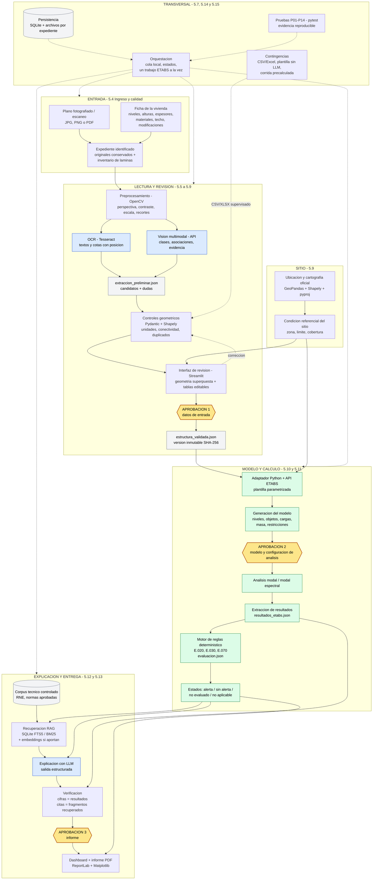

# Arquitectura de SismoVivienda AI

Arquitectura conceptual del flujo asistido para la evaluación sismorresistente preliminar de viviendas autoconstruidas (albañilería confinada, 1 a 2 niveles).

El flujo es híbrido: la IA interpreta información gráfica y redacta explicaciones; los algoritmos verifican consistencia y procesan indicadores; ETABS ejecuta el cálculo; el responsable técnico aprueba datos, modelo e informe.

## Diagrama

## Leyenda

| Color | Significado |
|-------|-------------|
| Amarillo | Puntos de aprobación humana (datos de entrada, modelo y análisis, informe) |
| Azul | Componentes de IA (OCR, visión multimodal, LLM) |
| Verde | Componentes de ingeniería (ETABS, reglas y evaluación) |
| Gris | Contratos de datos y almacenes |

Las líneas punteadas indican el bucle de corrección, la contingencia de visión (CSV/Excel) y el control de la orquestación sobre cada etapa.

## Las tres aprobaciones

1. **Datos de entrada:** permite construir el modelo.
2. **Modelo y configuración de análisis:** habilita el cálculo y la interpretación.
3. **Informe:** autoriza entregar el resultado preliminar.

Los errores y datos faltantes detienen la etapa correspondiente y se registran en el expediente.
